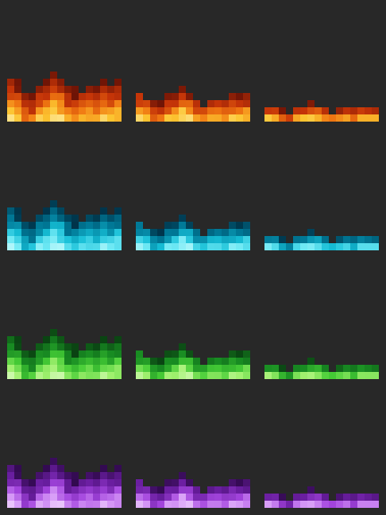

# Low Fire Texture Pack

Makes the burning effect much smaller on your screen. When you're set on fire (Fire Aspect, flame arrows, lava, fire blocks…), the flames only cover the bottom of the screen, so you can still see during PvP.

Comes in four colours (orange, blue, green, purple), each at three heights.



## Compatibility

| | |
|---|---|
| **Type** | Resource (texture) pack — no mod loader needed |
| **Minecraft version** | Java Edition 26.1 and newer |
| **Pack version** | 1.1.0 |
| **Side** | Client only — works on any server, nothing needed server-side |

## Dependencies

_None._

## Installation

1. Pick one file from `release/`. Files are named `low-fire-texture-pack-<colour>-<height>-1.1.0.zip`:

   | Height | Flame height | Orange | Blue | Green | Purple |
   |---|---|---|---|---|---|
   | `low` | 50% | `…-orange-low-…` | `…-blue-low-…` | `…-green-low-…` | `…-purple-low-…` |
   | `lower` | 35% | `…-orange-lower-…` | `…-blue-lower-…` | `…-green-lower-…` | `…-purple-lower-…` |
   | `lowest` | 20% | `…-orange-lowest-…` | `…-blue-lowest-…` | `…-green-lowest-…` | `…-purple-lowest-…` |

2. Drop the `.zip` (don't unzip it) into your `resourcepacks` folder:
   - **Windows:** `%APPDATA%\.minecraft\resourcepacks`
   - **macOS:** `~/Library/Application Support/minecraft/resourcepacks`
   - **Linux:** `~/.minecraft/resourcepacks`
3. In game: **Options → Resource Packs**, move the pack to the **Selected** column, then click **Done**.

## Special instructions

- **Use only one of these packs at a time.** If more than one is selected, the one highest in the list wins.
- **It affects fire everywhere, not just your screen.** Fire blocks and burning players and mobs also show the shorter (and recoloured) flames. Soul fire blocks are unchanged.
- **The fire is newly drawn art,** not Mojang's texture, so it looks a little different from vanilla.
- **Newer Minecraft versions:** the pack declares support for all future formats. If a future version ever shows it as "made for an older version", it will still load. Click through the warning.

## Building from source

The textures are generated by a script (needs Python 3 and Pillow, `pip install pillow`):

```bash
cd low-fire-texture-pack
python3 src/generate.py
```

This rebuilds every `.zip` in `release/` and `preview.png`. To add or change a height, edit `VARIANTS` in `src/generate.py`; for colours, edit `PALETTES`; to release a new version, bump `VERSION` and delete the old zips.

## Changelog

- **1.1.0**: Added blue, green and purple fire (soul fire style), each at all three heights. Files now include the colour in their name.

- **1.0.0**: First release. Original fire art in three heights (50%, 35%, 20%).
