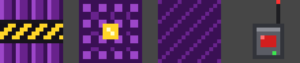

# Hyper TNT

A block of TNT as powerful as **2,500 TNT**, which only goes off when you trigger it with a remote **Detonator**. Set it off and you get an orbital-strike nuke: 2,500 lit TNT rain down from the sky in rings around it, from the centre outward. They leave a crater about **100 blocks across**.



- **Hyper TNT** can't be set off by fire, redstone, flint and steel or other explosions. It's also blast-proof, so it survives nearby blasts.
- **The Detonator** links to as many Hyper TNT as you like. Right-click the air and every linked charge goes off, from any distance.
- **No item drops:** blocks destroyed by the strike drop nothing, which keeps the game from lagging under thousands of items.

## Compatibility

| | |
|---|---|
| **Type** | Mod |
| **Minecraft version** | Java Edition 26.1.x, 26.2, 26.3 (one jar per version) |
| **Mod loader** | Fabric Loader 0.19.5 or newer |
| **Java version** | 25 (bundled with the Minecraft launcher) |
| **Mod version** | 1.0.0 |
| **Side** | Both: install it in your game; on a multiplayer server it must also be on the server (and every player needs it) |

## Dependencies

- [Fabric Loader](https://fabricmc.net/use/installer/), required.
- [Fabric API](https://modrinth.com/mod/fabric-api), required. Download the version that matches your Minecraft version.

## Installation

Three steps: install Fabric once, add the two mod files, then start the game with the Fabric profile. If you already installed Fabric for another mod, skip Step 1.

### Step 1: Install Fabric (one-time)

Fabric is a free mod loader. It adds a separate **fabric-loader** profile to the Minecraft launcher, and your normal (unmodded) profile keeps working as before.

1. **Run Minecraft once without mods** for the version you want (for example 26.1), then close it. This makes sure the game and your `.minecraft` folder exist.
2. **Download the Fabric installer** from https://fabricmc.net/use/installer/
   - **Windows:** click **Download for Windows** (an `.exe`).
   - **macOS / Linux:** click **Download universal JAR** (a `.jar`). You need Java to open it; if double-clicking does nothing, install Java 25 from https://adoptium.net/ and try again, or run `java -jar fabric-installer-*.jar` in a terminal.
3. **Run the installer** and on the **Client** tab:
   - **Minecraft Version:** choose the version you play (e.g. 26.1).
   - **Loader Version:** leave it on the newest.
   - **Launcher Location:** leave the default.
   - Keep **Create profile** ticked.
   - Click **Install**, wait for "Successfully installed", then close the installer.
4. **Open the Minecraft launcher.** Next to the **Play** button, pick the new **fabric-loader-26.1** profile (the number matches your version). If you don't see it, look under **Installations** and make sure it's enabled.
5. Click **Play** once to check it starts, then close the game. This also creates the `mods` folder.

### Step 2: Add the mod files

1. **Download Fabric API** (needed by almost every Fabric mod) from https://modrinth.com/mod/fabric-api: open the **Versions** tab and download the file for your Minecraft version. If it's already in your `mods` folder, you don't need another copy.
2. **Pick the Hyper TNT jar for your Minecraft version** from `release/`:

   | Minecraft version | File |
   |---|---|
   | 26.1, 26.1.1, 26.1.2 | `hyper-tnt-1.0.0+mc26.1.jar` |
   | 26.2 | `hyper-tnt-1.0.0+mc26.2.jar` |
   | 26.3 | `hyper-tnt-1.0.0+mc26.3.jar` |

3. **Put both jars** (Fabric API and Hyper TNT) into your `mods` folder. Don't unzip them. Create the folder if it doesn't exist:
   - **Windows:** press **Win + R**, type `%APPDATA%\.minecraft\mods`, press Enter.
   - **macOS:** in Finder, **Go → Go to Folder…**, type `~/Library/Application Support/minecraft/mods`.
   - **Linux:** `~/.minecraft/mods`

### Step 3: Play

Start the launcher, select the **fabric-loader** profile, click **Play**.

### Your server (only if you want it in multiplayer)

The server needs Fabric and the same two jars.

1. Go to https://fabricmc.net/use/server/, choose your server's **Minecraft version**, leave the loader and installer versions on the newest, and click the **Executable Server (.jar)** download button.
2. Put that jar in an empty folder for the server (or your existing server folder; back up its world first) and start it once:
   ```bash
   java -Xmx2G -jar fabric-server-mc.<version>-loader.<...>.jar nogui
   ```
   It downloads the game, then stops and asks you to accept the EULA: open `eula.txt`, change `eula=false` to `eula=true`, save.
3. Put **Fabric API** and the matching **Hyper TNT** jar into the server's `mods` folder.
4. Start the server again with the same command.

## Usage

**Get the items (creative mode):** open the creative inventory. **Hyper TNT** and the **Detonator** are in the **Redstone Blocks** and **Combat** tabs, or search for "Hyper". With cheats on you can also type:
```
/give @s hypertnt:hyper_tnt
/give @s hypertnt:detonator
```

**Set off a strike:**
1. **Place** Hyper TNT where you want the centre of the crater.
2. **Link it:** hold the Detonator and **right-click the Hyper TNT**. The message says "Linked Hyper TNT: 1 charge linked". Link as many as you like; right-click a linked one again to unlink it.
3. **Get clear!** Everything within about 50 blocks gets destroyed, players included. Go at least 70 blocks away, or watch from high up.
4. **Detonate:** hold the Detonator and **right-click the air**. Every linked Hyper TNT goes off at once, wherever it is (even in another dimension), and the links are cleared.

**What happens:**
- A deep charge-up sound plays.
- Rings of lit TNT drop out of the sky, starting at the centre and moving outward, for about 5 seconds.
- Each spot gets four TNT, one after another, so the later ones fall into the holes the first ones made. The ground erupts in waves.
- Everything ends about 10 seconds after you press the Detonator.

**Turn it off / remove it:** break any placed Hyper TNT first, then remove the Hyper TNT jar from your `mods` folder. Minecraft may warn about missing blocks when you open a world that used the mod.

## Special instructions

- **Creative only.** There's no crafting recipe. Survival players can only get the items from someone with cheats.
- **A short freeze is normal.** The busiest moment of a strike can freeze the game for a fraction of a second; see *How it was tested* below. On a slower computer, expect more.
- **The crater:** in solid stone, about 100 blocks across and 6–10 blocks deep. Dirt, sand and other soft ground goes deeper.
- **Nearby TNT and other explosives** in the area get set off too, as with normal TNT.
- **Far away is fine:** the strike keeps its area loaded while it runs, so it finishes even if nobody is nearby. It stops loading the area when it's done.
- **Multiplayer:** the server and every player need the mod.

## How it was tested

The mod was tested in a real game on 26.1, 26.2 and 26.3, each in a world with a 110 × 110 × 30-block slab of stone. The same checks passed on all three:
- Fire, a redstone block, and an exploding TNT next to Hyper TNT didn't set it off.
- Right-clicking it with the Detonator linked it, and right-clicking the air started the strike.
- Exactly 2,500 TNT dropped, and the strike finished on schedule.
- About 45,500–46,000 stone blocks were destroyed: a crater about 100 blocks wide, up to 10 deep.
- No item drops were left behind.
- An unlinked Hyper TNT 20 blocks from the centre survived.
- The strike released its loaded area afterwards.

**Performance during a strike:** the game averaged 35–40 ms of work per tick (it has 50 ms), with one busiest tick of 0.16–0.29 s. That's a brief hitch, not a lock-up. The test machine has no graphics card, so a normal gaming PC should do at least as well.

## Building from source

Needs Java 25 (e.g. [Temurin 25](https://adoptium.net/)). The Gradle wrapper downloads everything else.

```bash
cd mods/hyper-tnt
./gradlew build -Pmc=26.1     # or 26.2 / 26.3
# output: build/libs/hyper-tnt-<version>+mc<mc>.jar  → copy to release/
xvfb-run -a ./gradlew runClientGameTest -Pmc=26.1   # in-game test (drop xvfb-run if you have a screen)
python3 src/art/draw_textures.py                     # redraw the textures
```

Strike settings (number of TNT, rings, timing, drop height) are at the top of `src/main/java/io/github/thrawnis/hypertnt/Strike.java`.

## Changelog

- **1.0.0**: First release. Hyper TNT, Detonator, orbital-strike nuke with 2,500 TNT. Builds for 26.1.x, 26.2 and 26.3.
