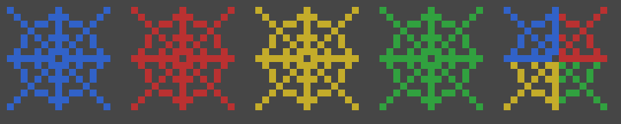

# Rainbow Cobwebs

Makes cobwebs partly see-through (70% solid) and slowly colour-changing. Every web fades blue → red → yellow → green and back again, spending about 3 seconds on each colour. Each web starts at a random point in the cycle, so a group of webs always shows a mix of colours.



## Compatibility

| | |
|---|---|
| **Type** | Resource (texture) pack. No mod loader needed. |
| **Minecraft version** | Java Edition 26.1 and newer (tested in 26.1, 26.2 and 26.3) |
| **Pack version** | 1.0.1 |
| **Side** | Client only. Works on any server; nothing is needed on the server. |

## Dependencies

_None._

## Installation

1. Drop `release/rainbow-cobwebs-1.0.1.zip` into your `resourcepacks` folder. Don't unzip it.
   - **Windows:** `%APPDATA%\.minecraft\resourcepacks`
   - **macOS:** `~/Library/Application Support/minecraft/resourcepacks`
   - **Linux:** `~/.minecraft/resourcepacks`
2. In game: **Options → Resource Packs**, move it to the **Selected** column, then click **Done**.

## Special instructions

- **Fades pass through in-between colours.** Going from red to yellow passes through orange, and from green back to blue passes through teal, so you'll also see those shades mid-fade.
- **Which colour a web starts on depends on where it is**, so the same web looks the same each time you visit, and other players using the pack see the same mix.
- **Inventory icon:** cobwebs in your inventory and hand show one quarter of the web in each colour. Item icons can't be random.
- **The web is newly drawn art:** a simple, thin-line web, not Mojang's texture.
- **Works alongside the other packs** in this repo.
- **Newer Minecraft versions:** the pack declares support for all future formats. If a future version ever shows it as "made for an older version", click through the warning and it will still load.

## How it works

The pack has four animated textures that each cycle through the same colours with interpolation, but each starts on a different colour. The cobweb blockstate lists all four models with equal weight, so the game picks one per block position (25% each). From 26.1 onward, partly transparent pixels in a block texture make the game draw it as translucent automatically.

## Building from source

Needs Python 3 and Pillow (`pip install pillow`):

```bash
cd rainbow-cobwebs
python3 src/generate.py
```

This rebuilds the `.zip` in `release/` and `preview.png`. Colours, fade order, transparency (`ALPHA`) and timing (`SECONDS_PER_COLOUR`) are at the top of `src/generate.py`. To release a new version, bump `VERSION` and delete the old zip.

## Changelog

- **1.0.1**: Webs are now 70% solid (were 50%).
- **1.0.0**: First release.
